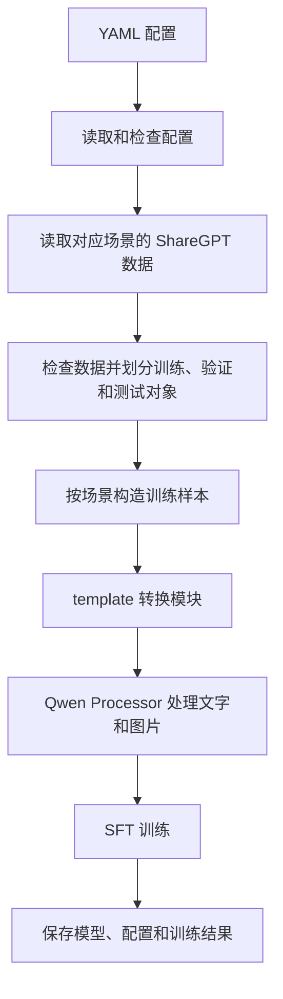

# 四种场景的后训练设计

本文记录已确定的模块职责，并作为第一版代码的实现依据。四种场景分别训练，代码从现有轨迹文件开始工作。

## 1. 我们要做什么

搭建一套由 YAML 配置驱动的后训练代码。用 Pydantic 定义并检查配置，用 `pydantic_yaml` 读取和保存配置。第一版实现 SFT，以后可以增加其他训练方法。

四种场景分别训练，分别保存模型，共用代码。每次默认从同一个基础模型开始，不把前一个场景训练出来的模型接着用于下一个场景。

| 场景 | 训练后的模型要做什么 | 样本如何构造 |
| --- | --- | --- |
| Single-view | 根据一张参考图生成脚本，根据渲染反馈修改脚本 | 每次生成或修改作为一个样本 |
| Multi-view | 根据多张参考图生成脚本，根据渲染反馈修改脚本 | 每次生成或修改作为一个样本 |
| ActiveVisual | 调用工具观察目标、调整视角、建模并修改 | 用已有历史预测下一步行为 |
| Full3DInteraction | 利用场景观测和工具操作完成重建 | 用已有历史预测下一步行为 |

两个交互场景第一版按日志里的工具执行方式设计。日志使用 `exec` 调用时，保留这个调用方式。改成直接调用 Blender 工具属于后续独立工作，需要同时调整数据和模型运行环境。

## 2. 整体流程



每个阶段都能单独运行。图片尚未修复时，可以先检查数据和预览样本，不必加载完整模型或启动训练。

## 3. 代码怎么组织

```text
configs/
  sft_single_view.yaml
  sft_multi_view.yaml
  sft_active_visual.yaml
  sft_full_3d_interaction.yaml

harness_training/
  config.py
  cli.py
  data/
    base.py
    trajectory.py
    validation.py
  templates/
    base.py
    qwen.py
  models/
    base.py
    qwen.py
  training/
    trainer.py
    collator.py
    methods/
      base.py
      sft.py

tests/harness_training/
docs/
outputs/post_training/
```

现有轨迹已经是 ShareGPT，后训练代码直接读取 `3DHarnessBench/runs/<setting>/gpt-6-astra/<instance>/post_train_trajectory/trajectory.jsonl`。不增加 ShareGPT 转换或重新导出数据的模块。

| 模块 | 负责的事情 |
| --- | --- |
| `config` | 读取 YAML，检查选项，保存最终使用的配置 |
| `data.trajectory` | 实现数据接口，读取现有文件、划分对象、选择训练内容 |
| `data.validation` | 检查图片和记录是否完整，记录不合格原因 |
| `templates.qwen` | 将已有 ShareGPT 转换为 Qwen 输入，明确训练目标 |
| `models.qwen` | 实现模型接口，加载模型与 Processor、设置参数和保存结果 |
| `training.trainer` | 统一入口，直接初始化各具体类，协调检查、预览和训练 |
| `training.collator` | 把样本组成一批，准备图片、文字和训练标签 |
| `training.methods.sft` | 使用训练后端执行 SFT，保存和恢复训练 |
| `cli` | 提供检查、准备、预览和训练命令 |

## 4. 数据和样本

直接使用现有 ShareGPT 文件：`conversations` 放对话，`system` 放任务说明，`images` 放图片路径，`tools` 放工具定义，`metadata` 放来源和步骤信息。图片路径以原始 JSONL 文件所在目录为起点解析。

数据层不另外创建对话文件或样本文件。它保留原始记录，在内存里选择对话范围和当前训练目标，再交给 template。检查结果、对象划分和拒绝原因可以保存为报告。

数据、template、模型和训练方法各用 `base.py` 定义职责接口。具体类直接初始化，不使用工厂。`Trainer` 本身没有父类：它是统一入口，连接各部分。

### Single-view 和 Multi-view

初次生成的输入是任务说明、参考图和生成请求，目标是完整脚本。

修改时的输入是任务说明、当前脚本、当前渲染、参考图和修改请求，目标是修改后的完整脚本。当前请求已经包含必要上下文时，不重复加入前面所有轮次。

失败回复默认不作为训练目标。成功修复失败脚本的回复可以作为目标，输入保留失败脚本和错误说明。先按执行状态筛选，再接入重建质量指标；执行成功不等于生成的物体足够相似。

### ActiveVisual 和 Full3DInteraction

每个样本使用某次行为之前的有效历史，目标是模型接下来应该输出的工具调用或回复。目标之后的截图、操作结果和最终产物不能提前放入输入。

第一版重点学习工具调用和最终任务回复。单独的状态播报默认不作为目标；如果说明文字与工具调用合在同一条回复中，保留完整行为，不随意拆开。无法可靠分类的回复要在样本预览中标明。

历史中的工具返回和 assistant 回复可以给模型看，但只对当前选定的目标计算训练误差。不同独立执行过程不能因为属于同一个物体就拼成连续历史。

### 共用规则

- 去掉与任务无关的插件推荐，保留实际建模约束。重复任务说明的进一步清理以后根据实际日志增加。
- 工具截图、场景信息和错误反馈是输入，不是模型要学着输出的答案。
- 不猜测、补写日志中没有的回复或工具返回，也不执行日志里的代码。
- 缺失或损坏图片的样本记录后跳过，数据修复后重新准备。
- 先把每个图片位置与文件绑定，再切分对话，避免图片错配；重复出现的同一张图仍保留各次位置。
- 原始日志保留不动，筛选结果与原因另存。

先按对象划分，再拆成样本，默认比例为训练 80%、验证 10%、测试 10%。同一对象的不同轮次必须进入同一份数据。四种场景使用同一份对象划分清单，方便比较四个独立模型。更严格的类别划分以后再增加。

## 5. template 转换模块

这里区分两件事：场景的任务说明告诉模型要做什么；模型的 chat template 决定一段对话如何排列、怎样表示角色和工具调用。转换模块负责后者，不改写任务要求。

`QwenTemplate` 接收已有 ShareGPT 记录，整理角色、图片和工具调用，再使用模型拥有的 Processor 编码。没有 `sharegpt.py`，也没有先转成另一种 ShareGPT 的步骤。

`QwenModel` 持有模型和 Processor。`Trainer` 初始化它，将 Processor 交给 `QwenTemplate` 使用，然后调用具体训练方法。检查数据时不加载模型；预览只加载 Processor；正式训练才加载模型权重。

转换模块提供两个主要操作：

| 操作 | 结果 |
| --- | --- |
| `render` | 显示模型会看到的内容，以及哪部分会被训练 |
| `encode` | 生成模型输入和训练标签 |

需要满足的条件：

- system、用户输入、工具结果、历史回复、图片标记和补齐位置默认不计算训练误差。
- 当前目标中的答案或工具调用及其结束标记需要被学习。
- 图片在工具返回里时，也必须被 Processor 处理，不能漏掉或移动到更早的位置。
- 训练和推理使用一致的对话格式及 thinking 设置。现有数据不含完整内部推理，第一版默认关闭 thinking。
- 使用模型配置确认架构；本地目录名字不能代替配置中的架构信息。
- 明确使用谁的 chat template，避免训练后端再次套模板或重复处理图片。

当前 ShareGPT 文件还保留了转换前后的消息映射。原来的步骤和执行过程边界必须通过这份映射定位，不能直接当成新对话的下标。对于明确标注为 Qwen 格式、已经写进 `gpt.value` 的工具调用，保留原有表示；纯 `function_call` 则转换为 Qwen 的结构化调用。无法可靠识别的样本记录后跳过。

交互数据目前没有统一的顶层 `tools` 字段。设计允许配置提供与实际执行环境一致的工具定义，数据中的定义存在时进行一致性检查。不能仅凭调用参数猜出完整工具定义。正式训练交互场景前，要把这项补齐并检查通过。

## 6. YAML 配置

四种场景各有一个完整配置文件，共享配置类型和代码。第一版不引入复杂的配置继承，方便直接看出一次训练用了哪些设置。

| 配置部分 | 内容 |
| --- | --- |
| `experiment` | 名称、场景、随机种子、输出位置 |
| `data` | 数据根目录、来源模型、检查规则、对象划分清单 |
| `template` | ShareGPT 约定、Qwen 模板、thinking 设置、工具定义 |
| `model` | 本地模型路径、精度、全参数或 LoRA、冻结哪些部分 |
| `method` | 当前为 SFT，以及对应训练参数 |
| `method` 内的运行选项 | batch、保存与验证频率、CPU／GPU 等 |

四个可读取的配置位于 `configs/sft_*.yaml`，字段以代码中的 Pydantic 模型为准。相同内容暂时各写一份，不引入复杂继承。对象划分按种子和对象名确定，因此四种场景对相同对象使用相同划分。

训练参数是起始值，正式训练前需要根据显存和样本长度调整。交互场景配置里的工具定义描述原日志使用的执行环境，并不实现该环境。部署时需要保持一致。

Pydantic 拒绝未知字段和不合理组合，例如 Single-view 配成另一个场景的数据。`~` 在读取时展开；相对配置路径以配置文件所在目录为起点解析，示例路径在实际文件中相应调整。所有模型、数据、模板和训练参数必须显式配置，不补默认值；`Trainer` 只接收配置并直接构造具体组件。恢复路径由 `method.resume_from` 指定，新训练填写 `null`。保存解析路径后的配置，作为本次训练的记录。

## 7. SFT、长度和输出

第一版优先采用 Transformers + TRL SFTTrainer，模型输入和训练标签由本项目控制。是否使用后端现成的图片处理与标签功能，以对本地模型的检查结果为准。全参数、LoRA 与训练方法分别配置，LoRA 不是另一种训练方法。

训练方法共用加载模型、日志、保存和恢复能力。SFT 接收已选好目标的对话样本。以后增加 DPO 时再增加偏好对样本；增加需要模型实际执行任务的训练方法时，再增加执行环境和奖励接口。训练方法通过 `BaseTrainingMethod` 定义共同操作，SFT 由 `SFTMethod` 实现。第一版不写空的 DPO 或强化学习实现，配置到未实现的方法就明确报错。

样本长度按 Processor 处理后的实际长度统计，图片占用也计入。第一版不随意截断，超过配置预算的样本记录后跳过，也不把多个样本拼在一起训练。报告跳过数量和比例，防止交互场景的大部分数据被无声丢掉。以后确有需要，再设计怎样选择更短但完整的历史。

每次训练放在独立目录：

```text
outputs/post_training/<scene>/<run_id>/
  resolved_config.yaml
  manifest.json
  data_report.json
  rejected_samples.jsonl
  checkpoints/
  final/
  metrics.json
```

记录数据文件及图片的指纹、划分清单、模板、代码、模型配置和依赖版本。断点恢复检查这些记录，避免接着使用已经改变的数据或处理逻辑。第一版不保存编码缓存。

如果使用 LoRA，`final` 保存 adapter、基础模型引用、Processor 和模板等运行所需信息；全参数训练则保存完整模型。评估时明确加载哪一份结果。

## 8. 使用方式、验证和实现顺序

计划提供以下命令，均读取同一个配置文件：

```text
post-train audit    --config <file>  # 检查日志和图片，生成报告
post-train prepare  --config <file>  # 在内存里选择训练内容，保存检查报告和划分
post-train preview  --config <file>  # 展示模型输入和训练目标
post-train train    --config <file>  # 执行训练
```

训练前重点验证配置、消息映射、图片顺序、工具调用与返回的对应关系、训练标签。覆盖单图、多图、工具返回图片、混合文字与调用、失败修复和缺失图片等真实情况。预览时用醒目的标记显示哪些文字会被学习。

先用少量样本完成一次短训练，确认输入、训练误差和保存恢复正常，再跑完整训练。硬件、训练精度、LoRA 设置和最大长度在这个阶段确定，不在设计阶段猜定。

SFT 第一版提供验证集 loss。任务评估以后接入 benchmark，检查脚本执行、物体相似程度和交互任务完成情况。四种场景分别报告，训练前后的模型使用同一批测试对象。实际 Blender 执行和交互评估使用单独的执行环境，不在读取数据时运行历史代码。

实现顺序：配置与数据检查 → 四种场景的样本构造 → template 转换与预览 → 模型加载和 SFT 短训练 → 保存恢复与评估接口。每一步有可检查的结果，再进入下一步。

技术格式参考：

- [ShareGPT 与图片、工具调用的数据约定](https://llamafactory.readthedocs.io/en/latest/getting_started/data_preparation.html#sharegpt)
- [Transformers 多模态消息与 Processor](https://huggingface.co/docs/transformers/chat_templating_multimodal)
- [TRL SFT 训练接口](https://huggingface.co/docs/trl/en/sft_trainer)
- [Pydantic YAML 读写接口](https://pydantic-yaml.readthedocs.io/en/stable/index.html)
